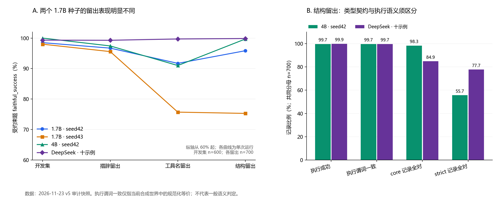

# ConsDAG v5：研究可行性、实验有效性与下一阶段决策报告

**报告日期：2026-11-23。证据版本：v5 审计快照；审计代码提交：`20859a9`。**

**2026-11-24 05:42续报：**1.7B三种子已全部完成，工具/结构faithful均值79.76%/82.90%，样本标准差10.53/11.28pp；原各切分非劣效H2未成立。4B43也已完成，44仍在跑。新种子的公开名称修复仅有有限收益，完整原始数字、配对区间和错误审计见[最新推进报告](v5_binding_progress_20261124.md)。以下保留23日证据快照，不能将其中“两种子”“待完成”作为最新状态。

本报告回答：当前结果好在哪里、坏在哪里；三个原始贡献还能保留什么；是否值得转向追问或有界修复；继续投入到 CCF-B 目标需要哪些证据。v5 优先于较早 v4 结论。v4 仅作为历史探索，不并入 v5 主表。

标记规则：**【事实】**指已存档数据、代码行为或可定位的一手原文；**【推断】**指证据支持但仍有解释边界的判断；**【待验证假设】**指尚未完成的新实验、因果解释或方法主张。计算出的逻辑上界属于事实，不等于已经完成统计检验。

本报告复用本地全文证据和已完成的审计，没有宣称本轮重新精读了全部论文或完成新的追问文献检索。服务器状态采用明确注明时间的快照，不作为实时状态播报。

## 1. 决策结论

**【推断】项目仍值得做一轮有上限的研究验证，但当前证据不足以称为“稳稳立足的 CCF-B 方法论文”。DeepSeek 很强不是判死刑；被否定的是当前数据上“小模型整体接近强模型”的主张。**

1. **①编译器可以保留，泛化与优势主张必须收缩。** 训练确实大幅改善当前小模型，但 1.7B 跨种子留出表现不稳定。可部署、输出结构化记录是资产；全面非劣、更快、更便宜、训练是唯一可行路径，尚不能作为结论。
2. **②原 GRPO 信用分解没有成立的正向实证。** 负结果应保留，不能因为换名称或奖励权重就恢复为算法贡献。下一项方法候选需通过独立试验。
3. **③配对可执行数据资产可以保留，独立贡献仍需补语义有效性和受控难度证据。** 程序检查通过不等于用户要求可恢复；工具名留出不等于工具结构泛化；当前结构留出也不是纯深度干预。
4. **优先完成冻结的绑定诊断，再做小规模“不确定性决策”可行性试验。** 基准作为证据基础；验证器与有界修复作为强基线。暂不把三个候选方向分别包装成三个新创新点。
5. **不建议现在扩大 GRPO。** 先让奖励对应所声称的任务、定位种子方差，并确认新难题存在可学习的收益空间。
6. **不采纳“只有一条救法”“CCF-C 稳”“B 概率不到五成”等判断。** 证据无法支持这些概率或录用保证，CCFA 概念评分也不是录用预测器。

各曲线是单次运行，不是三种子均值；左图纵轴从 60% 起。右图固定使用相同的 700 条受约束题，避免不同分母造成误导。

## 2. CCFA 规则怎样适用于当前项目

采用本地 [CCFA-Skills v0.12.1](../literature/ccfa_skills_v0.12.1/) 的概念评审、证据设计与校准原则。需要分别判断“概念是否值得开发”“结果是否支持主张”“论文是否已准备好投稿”。三者不可互相代替。

| 原始概念 | 历史分数 | 按该规则的区间 | 当前解释 |
|---|---:|---|---|
| ①约束编译器 | 4.13 | revise | 值得修订与验证，不是创新已确认 |
| ②约束锚定目标分解 | 4.18 | revise | 概念分不能替代机制收益证据 |
| ③配对可执行基准 | 4.28 | revise | 接近 4.3 也不能算作 accept-to-develop |

**【事实】**历史规则中 `≥4.3` 为 accept-to-develop，`3.7–4.3` 为 revise。改成追问或修复方法后，也不能沿用旧分数证明新方向成立。

**【推断】**最需要的是可否证的证据，而非继续为原分数加分。新方向的最近邻未查清时，不应先给出“无冲突”“首次”或新的精确评分。

## 3. 数据集：程序上可运行，研究有效性尚有边界

**【事实】**任务是将请求编译为 budget、deadline、privacy、tool_auth、order 五类约束，由固定规划器生成计划；环境单轮、模板化、每条受约束请求含 1–3 条约束，使用确定性检查器。

| 切分 | 任务组 | E/I/N 记录数 | 受约束 E/I 记录数 | 主要用途 |
|---|---:|---:|---:|---|
| train | 4,000 | 12,000 | 8,000 | 训练 |
| dev | 300 | 900 | 600 | 开发与诊断 |
| tpl_ho | 350 | 1,050 | 700 | 措辞留出 |
| tool_ho | 350 | 1,050 | 700 | 工具名称留出 |
| struct_ho | 350 | 1,050 | 700 | 多因素结构留出 |
| 合计 | 5,350 | 16,050 | 10,700 | 配对记录不视为独立任务组 |

修正基线评分后，全量验证仍为 PASS；检查范围内 query、task-goal、group-ID 跨切分精确重叠为零。构造的可行计划、约束满足与最低改动数量检查通过。[完整数据复核](../outputs/v5_analysis/verification_audited_20261123.json)

**【推断】**这些检查排除了对应程序错误，不能推出“数据集已没有问题”。还有四个边界：

- **语言有效性：**请求与金标出自同一生成体系。存在满足金标的计划，不证明读者能从请求恢复金标，也不证明隐式信息没有多解。
- **留出强度：**tool_ho 主要改变名称；struct_ho 同时改变名称、阶段数、备选工具数、结束结构和授权锚点。分数高不能单独归因为学会了更深推理。
- **表达状态：**E/I/N 是显式、隐式、无约束，不是“可恢复、不可恢复、无需恢复”。隐式可以信息充分，显式也可以缺必要参数。
- **可信范围：**隐私、授权等是可信约束的合成案例，不等于真实隐私保护、沙箱安全或企业生产有效性已验证。

**建议保留 v5 为固定历史基准，不覆盖测试集。** 新深度、新歧义与新政策轴使用独立版本和假设；不得根据 DeepSeek 的测试失败定向出题后声称是独立测试。

## 4. v5 结果：强模型确实很强，小模型收益真实但不稳定

### 4.1 执行主指标

定义：`faithful_success = 任务完成 ∧ 满足金标约束 ∧ 改动数等于金标最小改动数`。金标用于离线评测，不是部署输入。

下表均为受约束 E/I 记录的百分比。dev 分母 600，其余每列 700；SFT 不同种子分别展示。

| 系统 | dev | tpl_ho | tool_ho | struct_ho |
|---|---:|---:|---:|---:|
| Qwen3-1.7B SFT seed42 | 98.50 | 96.71 | 91.71 | 95.86 |
| Qwen3-1.7B SFT seed43 | 98.00 | 95.57 | 75.71 | 75.29 |
| Qwen3-4B SFT seed42 | 100.00 | 97.43 | 91.00 | 99.71 |
| DeepSeek-v4-pro-0813 十示例 | 99.33 | 99.29 | 99.71 | 99.86 |
| qwen-max 零示例 | 83.83 | 86.00 | 81.86 | 79.29 |
| qwen-max 十示例 | 88.33 | 84.14 | 87.86 | 86.57 |

**【事实：快照更正】**当前 qwen-max 十示例磁盘缓存已完整覆盖 4,050 条记录，请求指纹与训练示例哈希均匹配。较早“struct 缺 10 条”已不适用于这份缓存。本轮没有新增 API 请求，复算得到 struct=86.57%。解析失败与截断仍计入分母。[复算结果](../outputs/v5_analysis/qwenmax_tenshot_rescore_20261123.json)

**【推断】**训练使小模型适应了此任务，但 qwen-max 不能代表所有强模型。DeepSeek 已反驳“提示词普遍失效”。它接近天花板提示当前测试区分能力有限；尚不能仅据此判定泄漏，或断言它只依赖领域知识。

0.6B 历史结果不补入此表：本次主审计快照没有纳入可确认完成的同版 v5 0.6B 运行。旧版高分不能混入 v5 尺度比较。

### 4.2 N 版误报

下表为 N 版约束误报百分比，分母 dev=300、其余=350。1.7B 是两个已完成种子的平均，其余是单配置；与上表分母不同。

| 系统 | dev | tpl_ho | tool_ho | struct_ho |
|---|---:|---:|---:|---:|
| 1.7B SFT，两种子平均 | 0.50 | 8.00 | 0.29 | 0.00 |
| 4B SFT seed42 | 0.00 | 6.57 | 0.00 | 0.00 |
| DeepSeek 十示例 | 0.33 | 0.00 | 0.86 | 2.00 |
| qwen-max 零示例 | 57.67 | 53.71 | 47.43 | 60.57 |
| qwen-max 十示例 | 28.67 | 34.00 | 39.71 | 46.00 |

**【推断】**N 误报不能直接证明追问路线成立。明确豁免时应直接返回空约束；反复询问可能把误报转成无必要打扰。DeepSeek 误报已较低，新方法必须接受这个强对照。

### 4.3 执行成功与字段契约不能混为一谈

**【事实】**对相同 structure-HO 的 700 条受约束题联合计数：

| 系统 | faithful | 规范化执行谓词全对 | core 记录全对 | strict 记录全对 | 含 evidence 全对 |
|---|---:|---:|---:|---:|---:|
| 4B seed42 | 698/700（99.71%） | 698/700（99.71%） | 688/700（98.29%） | 390/700（55.71%） | 390/700（55.71%） |
| DeepSeek 十示例 | 699/700（99.86%） | 698/700（99.71%） | 594/700（84.86%） | 544/700（77.71%） | 544/700（77.71%） |

core 比较 type+params 的约束多重集；strict 还比较约束的 state、severity、scope 及顶层 query_state；含 evidence 再加入原文证据要求。规范化谓词将当前环境中执行等价的表示归并，只用于本环境诊断。

此前 4B 的 record_exact≈70.5% 使用包含 350 条 N 的 1,050 条分母。**受约束记录 strict 全对率为 55.71%，不是 70.5%。** strict F1≈0.72 是约束级集合指标，也不能解释为记录全对率。

**【事实】**当前环境将 tool_auth 与 order 的对应参数映射为相同的条件先后关系。4B 有 10 条 core 不同但 faithful 成功，其中 10 条执行谓词等价；DeepSeek 对应 105 条中 104 条等价。不能据此否定 DeepSeek 的执行高分。

在冻结的 72 条 dev 受约束题上，分别破坏金标 scope、state、severity、evidence，其余保持不变，四种干预均仍为 72/72 faithful。这是 oracle 程序干预，不是模型收益；它证明当前执行链不消费这些字段，不证明字段一般无价值。

**【推断】**需要分别处理：

1. 真正执行等价的表示：保留契约评分与执行等价评分，不能为放大模型差距而把同义输出判为执行失败。
2. 声称字段有安全收益：构造字段确实影响执行或审计的情境并验证，不能只是接入奖励、人工制造扣分。

例如区分授权和普通顺序，环境应有审批主体、适用范围或失效状态等决策语义。这是新数据设计，不能回改当前标签改变既有胜负。[联合审计](../outputs/v5_analysis/measurement_audit_20261123.json)

## 5. 种子方差与原 H2：先确认问题，再谈强化学习增益

**【事实】**两个 1.7B 运行的数据哈希及记录的训练脚本哈希一致；已记录配置差异只有 seed、输出目录和是否跳过训练前零示例评测。均为 bf16、3 epochs、lr=2e-4、LoRA r16/alpha32、累积 4、max_seq_len=1280、max_new_tokens=384。

| 切分 | seed42−seed43 | 配对任务组 bootstrap 95% CI |
|---|---:|---:|
| dev | +0.50pp | [−0.83,+2.00]pp |
| tpl_ho | +1.14pp | [−1.00,+3.29]pp |
| tool_ho | +16.00pp | [+11.71,+20.29]pp |
| struct_ho | +20.57pp | [+16.86,+24.43]pp |

按任务组重采样并保留 E/I 配对，区间**条件于两份已训练权重**，不是训练 seed 总体区间。tool 有 141 条仅 seed42 成功、29 条仅 seed43 成功；struct 为 162 与 18。分别有 91、123 个任务组更偏向 seed42，不能解释成一两条题偶然变化。

**【推断】**证据支持训练结果对留出条件存在实质敏感性；尚不能区分覆盖不足、优化路径、过拟合或共同作用，也没有证据直接归因为新 NaN 或硬件故障。

判定顺序：

1. **完整性：**模型/数据/适配器版本、提示、截断、解码、ID 对齐和评分器。部分已核对，未核对项不默认为一致。
2. **优化有效性：**有限性告警、梯度范数、学习率、有效目标 token、开发集随训练步的变化。低训练 loss 不证明泛化稳定。
3. **覆盖与绑定：**用冻结干预测目录和角色名称影响，再按约束组合、角色对、政策链检查覆盖。按错误选出的题只作诊断。
4. **方差分解：**固定数据改变训练随机性，固定训练设置改变独立数据采样；先小试定位，再决定是否全面重训。
5. **方法增益：**若 GRPO 增益小于 SFT 跨种子波动，单 seed 正向结果不够有说服力。

原 H2 要求三种子均值相对 DeepSeek 十示例、每切分 95% CI 下界大于 −3pp。即使第三种子 100%：

`tool 均值上限 = (91.71 + 75.71 + 100) / 3 = 89.14%`

`struct 均值上限 = (95.86 + 75.29 + 100) / 3 = 90.38%`

与 DeepSeek 仍差 10.57pp、9.48pp，均值门槛也无法追回。**1.7B 原三种子 H2 不可能靠补一个好种子挽回**；第三种子仍有复现和诊断价值。

4B 只有一个完整种子。tool 点差 −8.71pp；tpl 点差虽仅 −1.86pp，条件 CI 下界为 −3.43pp，也不能写“除 tool 外均已非劣”。正式状态仍等待注册种子；完成后还需遵守注册的多重比较规则。主分析已阻止不足三种子直接宣布通过。

证据：[配对差异](../outputs/v5_analysis/seed_disagreement_1.7b_42_vs_43.json)、[完整主分析](../outputs/v5_analysis/main_audited_20261123.json)。

## 6. 原始三个贡献还能保留什么

| 贡献 | 可保留的资产与问题 | 必须撤回或降级的主张 | 形成完整贡献的条件 |
|---|---|---|---|
| ①独立编译器 | 小模型、类型契约、证据记录、与规划分离的接口及训练管道 | 整体逼近强模型；训练是唯一路径；校准拒判已成立；接口存在即证明通用迁移 | 稳定复现、独立措辞/结构验证、至少一个非平凡的风险/质量/部署权衡优势 |
| ②锚定信用分解 | 奖励与执行审计、失败样本、解释/搜索干预经验 | GRPO 已有效、外部锚天然抗 hacking、拆出约束自动获益 | 同预算强基线上的稳定收益，漏检、过改、无效计划反例审计 |
| ③配对基准 | E/I 配对、N 对照、可行性证书、检查程序、角色与字段标注 | 三版语义等价；自动检查等于语言有效；名称留出等于结构迁移 | 独立语义证据、受控难度轴、组合留出、真实决策差异与边界 |

**【推断】**①③的资产和问题可以继续用，但不能折算成创新百分比。②目前适合作为负结果或诊断材料；是否替换为追问机制，由新 pilot 决定。

方法可以围绕通用的请求约束、证据与执行决策表述，实验落在 DAG 工具环境。不必为形式通用性扩展到代码、文本回答等不相关领域；也不能写未测试的跨规划器能力。师兄“不绑定某一篇基座论文”的建议，本身不等于要求增加跨规划器实验。

## 7. 与相关工作的可核查对照

下表只使用已有本地全文和引文台账支持的窄结论。URL 用于定位来源，不表示本轮核验了正式发表 venue。新追问路线的完整近邻检索仍未完成。

| 相关工作 | 一手证据支持的重叠 | 对本项目的影响 | 可继续研究的差异，尚非首创证明 |
|---|---|---|---|
| [ATLAS](https://arxiv.org/abs/2509.25586) | 已讨论请求中显式或隐含约束 | 不能称首次发现隐式约束 | 紧凑编译器的稳定性、执行接口与风险决策 |
| [CGAP](https://arxiv.org/abs/2610.41040) | LLM 将请求转目标，记录 evidence spans；授权、隐私、适当性留给应用 | 请求解析和 evidence 已有近邻，不能称其完全不处理用户语言 | 哪些要求可恢复、哪些需询问，以及执行成本 |
| [LangNCO](https://arxiv.org/abs/2610.23190) | 自然语言约束编译；检查器不验证语义一致 | 编译叙事不新；结构合法不等于忠实理解 | 可执行性与语义忠实分开测量 |
| [NOMOS](https://arxiv.org/abs/2610.11030) | 报告本机 26B 编译，以书面政策存在为前提 | 本机运行不构成独立新颖性；其“不显著较差”不自动等于正式非劣效 | 请求内约束、政策适用条件与信息不足处理 |
| [TAG](https://arxiv.org/abs/2610.21404) | 锚点满足后门控辅助信用 | 不能称首次信用门控；外部锚差异需体现为可检验效果 | 独立执行检查怎样限制错误信用，仍留哪些漏洞 |
| [RLVP](https://arxiv.org/abs/2607.07435) | 路径惩罚；规则人工指定，自动发现具挑战 | 自动发现是动机，不证明我们已解决它 | 遗漏、误拦与功能成功的联合验证 |
| [LEVER：项目与论文入口](https://github.com/niansong1996/lever) | 按输入、候选程序与执行结果训练验证器 | 执行反馈筛选与验证器引导不是空白 | 约束不完整时验证器能知道什么，有限修复如何避免过改 |

原文定位见 [v5 设计引文台账](design_v5_ccfb.md)：ATLAS L167、CGAP L23/L425/L1030、LangNCO L342、NOMOS L29/L2969、TAG L32、RLVP L870、LEVER L21 附近。作者承认的局限性不自动构成我们的新颖性证明。

**【推断】**“小模型 + 约束 + 执行器”仅凭组合名称不足以立住。值得核验的具体问题是：**在什么证据条件下应执行、询问或拒绝，怎样用可核查的执行后果评估决策？** 选择性预测、校准、conformal、追问各自已有研究基础；连接起来是否产生新机制或发现，需要检索与实验。

## 8. 对 Trae 三条路线的判断

### 8.1 不确定性编译：值得小试，不能直接宣布成立

**【推断：同意】**转向错误执行成本、有限追问预算和安全完成，更接近系统需求，也不必以击败 DeepSeek 一次生成分数为前提。

**【事实：需修正】**E/I/N 不是信息充分性标签；当前 v5 没有已验证的必须追问样本。qwen-max 误报高不能推广到 DeepSeek。当前 confidence 也不是已监督、已校准的可信测量。

**【待验证假设】**系统能识别“现有信息不足以作出低风险决定”，以一次有针对性的追问减少错误执行，同时在充分和豁免题上避免打扰。比较对象应包括同样可追问的 DeepSeek。

必须区分三种情况：

- **模型不确定：**答案已在输入，模型没读懂。理解、搜索或修复可能更合适。
- **信息不足：**两个真实状态都与公开输入兼容，却需要不同决策；任何模型都不能凭空知道哪个是真的。
- **行动不敏感：**解释有歧义，但同一计划在两种状态下都安全、代价可接受；未必值得追问。

不能把两个可能解释直接标成“必须问”。应同时检查安全计划交集、功能收益、过改代价与询问成本。若所有歧义题都带明显缺失标记、一条规则即可问对，也不能证明学习方法必要。

建议 pilot 为 **120 个独立情境组**：40 信息充分、40 关键参数/政策不足、40 明确豁免；按组隔离校准 30、开发 30、测试 60，各类分层分配。只有不足组需至少两个公开输入兼容、决策可能不同的隐藏状态；充分与豁免组应有确定解释。此规模用于可行性，不承诺最终统计功效。

回答器只返回所问字段，不泄漏完整金标或最优计划；允许的澄清后应消除决策相关歧义。语言有效性要有独立于原生成器的检查；暂不安排人工时明确保留缺口，不把模型一致性冒充人评。

对照：从不追问、总追问、随机预算追问、固定置信阈值、简单风险/规则策略、同预算强模型。指标：预算下安全完成、错误执行成本、无必要追问、覆盖率、追问后恢复、总调用/token/时延。ECE/Brier 只作辅助。

Conformal 的保证依赖其方法假设及校准设置，不自动覆盖结构 OOD 或政策变更。独立校准组定阈值，同时报告风险与覆盖。

**停止或改向条件：**允许的澄清后仍无法确定决策事实；标成充分的题实际欠定；收益来自答案泄漏；同预算强模型/简单规则持平且无其他价值；收益仅由清晰 N 上过问产生。询问前无法唯一确定状态本身是设计目标，不是停止条件。

### 8.2 验证器与有界修复：保留强基线，不能当作已成立主贡献

**【事实】**历史 E2 的约 +33pp 计划修复收益来自特定候选与约束条件，同时有符号求解器近持平、N 过度改动等限制；它不是编译语义修复成功的证据。

部署验证器只能使用公开工具语义、政策和实际获得的用户信息。它能检查计划满足输入约束，却无法只凭错误编译结果发现所有漏掉的真实要求。离线评分可用金标；在线修复用隐藏金标是 oracle 上界。

**【待验证假设】**小模型加有限验证/修复可在相同风险目标下获得更好资源权衡。强模型必须得到相同验证器和预算，至少比较纯符号求解、直接编译、验证筛选、有限修复，避免把求解器能力算给模型。

可比较 k=0/1/2 次修复，记录纠正了什么、是否改变语义、是否破坏原来正确部分。若收益只来自 JSON 修复，或简单符号规则等效且更便宜，应收缩为工程优化。

### 8.3 深度基准与失败诊断：可靠资产，不是自动保底录用

**【推断】**最能复用资产，但更难的合成题还不够。需要说明失败原因、干预因素与适用范围。

优先一次增加一个可验证维度，例如多跳政策适用链；固定词汇与输出契约，比较 1/2/3 跳。之后再正交加入重命名或约束组合。证明必要推理步骤确实增加、简单表面规则不能代答；不要一次叠加检索、多轮、冲突和层级 scope。

独立基准论文需独立语言样本、构造/标注质量、非平凡控制基线、复现材料和能改变认识的发现。不能因叫“基准”就判低档，也不能因工程完整就保证录用。

**推荐组合：**③提供数据基础，①探索风险驱动执行/追问，验证修复作公平对照。先证实一个主机制，不硬凑三个贡献。

## 9. SFT → GRPO：科学上可试，现在不宜扩跑

**【事实】**DeepSeek 十示例四切分为 99.29%–99.86%，当前平均执行分上升空间很小。1.7B 自身还有改善空间，但改善不自动意味着超过强模型或方法新颖。

历史 v4 三个 RL 变体相对 SFT 的安全完成净变化为 +1/−3/−6 条（分母 80）；function 臂仅 20/128 组产生非零优势，没有稳定正向证据。其实现没有 KL、PPO 裁剪，但不能仅凭 ratio=1 判梯度无效：首个 on-policy 更新比值为 1 可以正常，须检查实际优势、梯度和更新。

**【推断】**浅模板上直接强化学习可能强化输出习惯或奖励捷径，不能保证避免 E2 失败。要先改变可验证的问题条件，不是只换训练器名称。

| 必要条件 | 操作要求 | 失败信号 |
|---|---|---|
| 奖励对齐 | 功能、安全、干预成本分开记录；训练金标可用于离线奖励，测试金标不进入部署 | 只对预测约束计分，漏掉真约束无惩罚 |
| 有效反馈 | 稠密反馈来自独立可检查状态/违反，不是字段数量 | 多写约束、伪造证据/置信度加分 |
| 反规避 | 检查无效计划、不行动、遗漏角色、N 过改和最小改动并列解 | 不可执行时反而免除应承担的代价 |
| 学习空间 | 结构定义难度；组内有有效且质量不同的候选 | 多数组全对或全错，优势近零 |
| 稳定优化 | bf16、有限性/梯度检查、适用的参考策略约束，监测 KL/熵/长度 | 长度或 KL 失控、重复坍缩、非有限数值仍更新 |
| 公平对照 | 同数据与资源账本比较继续 SFT、筛选 SFT、GRPO | 仅同 rollout 轮数，实际开销不等 |
| 校准 | 独立校准集定阈值，测风险—覆盖与误问/漏问 | 自报 confidence 或 ECE 单独证明安全 |
| 统计 | 同起点配对比较，正式三种子，保留组相关性 | 只报最好 seed、挑测试切片、反复调到显著 |

外部程序可减少直接操纵评分器的自由度，不等于不会被钻空子。若不可执行时整个约束项置零，而无效输出同时逃避惩罚，就有漏洞；功能失败和违规记账应一起审计。

过程奖励**不是必需条件**。只有中间推导可独立验证、确实增加有用反馈时才值得加。不可核验的文字思维链或模型自评不能当可信稠密奖励。

“GRPO 用于生成/筛选数据”还需澄清：生成、验证筛选再 SFT 本身不需要 GRPO。**先试验证筛选数据或有界搜索，更容易隔离收益来源；有明确采样策略学习需求后再考虑 RL。**

## 10. 最小实验路线、资源与停止条件

以下是顺序决策，非全部已启动。预算为现有 RTX 4080 SUPER 32GB 单卡粗估，需用前 100 条推理或前 100 训练步校正；API 单独记账，不计作我们的 GPU 小时。

| 阶段 | 内容与模型 | 状态 | GPU 小时量级 | 继续/停止条件 |
|---|---|---|---:|---|
| A 审计 | CPU 重评分、配对统计、字段干预、基线口径统一 | 已完成报告覆盖部分 | 0 | 明确指标测什么，不改成有利于自家模型的刻度 |
| B 绑定诊断 | 冻结 1.7B seed42/43、4B seed42；原输入/目录打乱/角色 ID 置换 | 已冻结并排队，未出生成结果 | 约 1 | 简单改名/顺序导致退化则先修绑定与覆盖 |
| C 追问可行性 | 120 新情境组；冻结两个 1.7B 与 DeepSeek，同问答预算 | 提议，未构造完成 | 约 1–4，先按 6 封顶估算 | 数据先通过有效性检查；简单规则解释全部收益则不扩训 |
| D 监督修订 | B/C 给出机制后，1.7B 新数据或决策监督，seed42/43/44 | 条件阶段 | 三次训练和评测约 6–15 | 留出稳定且超过同预算继续 SFT，否则重新定位 |
| E RL 探针 | 一个冻结起点，继续 SFT/筛选 SFT/GRPO，先一个配对种子 | 条件阶段 | 首轮总预算约 3–6 | 无增益、过问过改、优势大量为零或失稳即停止 |
| F 正式复核 | 通过后补三种子、独立测试、关键消融 | 未启动 | 按 D/E 实测，十余至数十 | 预先固定最小有意义收益与统计；不稳则报告负结果 |

这不是“再跑十小时就够 B”的承诺。若 C 无法产生可信的决策问题，不用 D/E 延长未成立的设定。暂不要求全面重跑 0.6B 或增加大模型；0.6B 可在方法成立后补部署曲线，4B 作为能力参照。

建议预先登记门槛：

- **任务有效：**证书无矛盾，回答不泄漏金标，独立语义检查无系统性欠定；否则修数据。
- **实用收益：**固定询问预算，开发集安全完成提升至少 3pp，或不降低安全完成时错误执行成本相对降低至少 20%。这只是建议的投资门槛，需在看新测试前按实际成本确定，不是录用标准。
- **可学习性：**长期仅少数组有有意义的质量差异，则先修采样/课程；不为制造优势给格式差异发奖。NaN/Inf 立即失败退出、留存诊断。
- **最终统计：**各 seed 与均值/离散程度均报告；bootstrap 保留任务组配对并注明条件性。三种子不足以精确估计随机性的总体尾部风险。

若仍主张所有切片非劣，保持事先规定的切片和比较程序；不在结果出来后只保留好切片。新成本/风险假设单独登记，不覆盖原 H2 失败。

## 11. 效率与强模型的公平角色

**【事实，历史 v4 小面板】**30 请求测量：1.7B 中位延迟 2.93 秒、完整正确 17/30；4B 3.45 秒、20/30；DeepSeek 十示例 2.65 秒、29/30。API 并未比小模型慢。十示例平均输入 8,731.7 token，小模型 724.7，但 API 输入有 97.5% 命中缓存。

同硬件、固定 512 输入和 64 输出 token 测量中，1.7B 相对 4B 约快 1.30 倍；仅支持该硬件/精度/批量下两个本机模型的对比，不能推出快于 API。自托管由租用服务器模拟，无外部模型调用不等于整个系统已获安全保证。

**【推断】**目前可守的是可自托管、减少示例上下文和较低显存需求；等质量成本更低尚未证明。需计入训练摊销、GPU 利用率、缓存、网络、重试和修复。少 token 不等于少钱，快但明显不准也不是等质量优势。[详细测量](compiler_efficiency_v1.md)

强模型应承担三种角色：能力对照，避免弱基线制造必要性；任务区分度参照，暴露浅层天花板；完整系统对照，享有相同追问/验证/修复接口和合理预算。

**【推断】**不必打败强模型才有论文价值；但仅在浅合成任务接近它，不足以支撑本项目期望的方法贡献。追平需明确可测的权衡；难切片超过需证明独立、公平、稳定，并解释机制。

## 12. 距离 CCF-B 还差什么

| 证据项 | 当前状态 | 最小补充 | 作用 |
|---|---|---|---|
| 最近邻与新颖性 | 原方向有全文台账；新追问未专门查全 | 核验选择性预测、澄清、工具政策问答、修复近邻及机制差异 | 区分研究贡献与直接组合 |
| 语义有效性 | 程序通过，独立语言证据不足 | 独立措辞/语义核查，欠定与豁免明确，争议和剔除规则公开 | 确保测试确实测目标问题 |
| 稳定性 | 1.7B 两 seed 大分叉，4B 一个完整 seed | 复现、绑定诊断、方差定位，再评估修订 | 防止最佳 seed 误导 |
| 机制收益 | 原 RL 未成立；新方向未证实 | 一个范围清楚的机制，同预算强基线、关键消融 | 决定能否写方法论文 |
| 评测契约 | 字段与执行脱钩、部分类型等价 | 保留分层指标，对真正影响决策的字段做干预 | 不让字段 F1 与执行成功互相冒充 |
| 外部适用性 | 单一合成世界 | 独立语言/政策来源或可验证的独立分布，范围与主张相称 | 减少生成器自证限制 |
| 成本优势 | 有局部测量，无等质量货币优势 | 共同质量目标下的端到端资源曲线 | 效率路线的主证据 |
| 可复现性 | 已有哈希、审计、代码结果 | 冻结版本，保留失败，区分 oracle/部署能力 | 可复算、可审查 |

**【推断】**缺口主要在研究主张与证据之间，不是再补尺寸或文案。至少需要有效问题、有说服力的方法或诊断发现、独立且稳定的证据。现在不能称已达到 CCF-B 投稿证据状态，也不能断言没有机会。

最终口径由结果决定：

- **风险决策成立：**证据不足时约束编译的执行/追问权衡，配对情境与同预算强基线支撑机制。
- **仅追平但资源优势可靠：**给定部署条件和执行质量目标下，紧凑编译系统的成本权衡；少 token 不能替代成本证据。
- **新方法无优势但诊断扎实：**类型契约与执行语义的差异、绑定敏感性、种子不稳及配对基准。价值取决于发现的普遍性和数据有效性，不预判 venue 档次。

## 13. 已完成工作、排队状态与材料

### 13.1 审计链已完成的工作

- H2 仅在注册 seed42/43/44 到齐时允许确认；运行发现要求 metrics 和预测齐全。
- 区间标为条件于已有 seed。保留 H3/H4 注册计算，但多因素切分不作为结构迁移因果证明，模型一致性不作为人类语义验证。
- 保守基线原按与某一 gold plan 完全相同判 faithful，模型按同最小改动数判；已统一为安全且最小改动数相同，测试两条同优计划。修复后该基线受约束 faithful 仍为 0，只能排除这个特定策略。
- 本机相关测试 73 passed / 2 skipped；两项 NaN 测试因本机 torch 不可用跳过，未算通过。远端增量 4/4 通过，测试依赖在独立目录，不改训练环境。
- 本轮报告/图表只用冻结 JSON，不新增模型预测，不改变历史分数或运行中的训练代码。

### 13.2 已排队绑定诊断

旧 dev 固定哈希抽 36 组，1/2/3 条约束各 12 组，每组 E/I/N，共 108 条/条件。原输入、只打乱目录、保留工具说明的角色 ID 双射置换分别比较。每项只动一个因素；witness 可行、最小改动数、证据子串均已验证。

冻结 1.7B seed42/43、4B seed42，各 324 次，共 972 次贪心生成；bf16、batch8、max_new_tokens384。记录输入输出、哈希、长度、用时与逐条件分数。这是开发集诊断，不是独立最终测试或深度实验。

[run_v5_binding_after_queue.sh](../scripts/run_v5_binding_after_queue.sh) 在 `/root/ConsDagDiagnostics20261123` 等既有 E1 队列完成，并检查 GPU 无计算进程、显存低于 1GiB；使用诊断锁、模型间再检查和 48 小时等待上限。检查用于避免争抢已知任务，不等于预占服务器或保证没有外部任务瞬时启动。

**最后可确认快照：2026-11-23 22:23，北京时间。** 4B seed43 为 4300/9000 步，最近 loss=2.20e-6；RTX 4080 SUPER 32GB 利用率 92%、显存 32208/32760 MiB。原队列 PID117741、训练 PID135102、诊断等待 PID137446。此后本报告未重新查询，不能写成实时状态或称诊断已完成。

### 13.3 23:32 运行状态补记

【事实】2026-11-23 23:31:57（北京时间）重新只读连接服务器，4B seed43 同一进程仍在训练。最近记录为 7800/9000 步（86.7%），loss=1.53e-6；GPU 利用率 81%，显存 32208/32760 MiB。该运行现有日志未匹配 NaN/Inf loss、非有限数值告警、Traceback 或 OOM；尚无最终 metrics 或 trained 预测，不能据低 loss 推断评测成绩。

现有队列 9 个注册运行中，1.7B seed42/43 与 4B seed42 已完成，4B seed43 为第 4 个。其后按脚本顺序为 1.7B seed44、4B seed44、0.6B seed42/43/44。绑定诊断等待进程仍在，尚无生成结果。未抢占、重启或更改现有训练。

【推断】最近 400 步用时约 491.5 秒，剩余 1200 步按相同速度约 25 分钟，之后还需完成评测；这是训练剩余时间估算，不是最终结果完成承诺。本次未新增完整模型结果，前文科学结论不变。

状态原始记录：[gpu_status_latest.json](../outputs/v5_analysis/gpu_status_latest.json)。该检查器本次正确读取了正在运行的 4B 日志；带小数点的 1.7B 日志路径在本次采集时未读到，因此本次不据该快照追加对已完成 1.7B 训练日志的无异常保证。

### 13.4 可复算材料

| 内容 | 文件 |
|---|---|
| 主分析与条件区间 | [main_audited_20261123.json](../outputs/v5_analysis/main_audited_20261123.json) |
| 数据构造检查 | [verification_audited_20261123.json](../outputs/v5_analysis/verification_audited_20261123.json) |
| 字段、执行等价、配置审计 | [measurement_audit_20261123.json](../outputs/v5_analysis/measurement_audit_20261123.json) |
| 种子配对差异 | [seed_disagreement_1.7b_42_vs_43.json](../outputs/v5_analysis/seed_disagreement_1.7b_42_vs_43.json) |
| qwen-max 完整复算 | [qwenmax_tenshot_rescore_20261123.json](../outputs/v5_analysis/qwenmax_tenshot_rescore_20261123.json) |
| 注册设计与引文定位 | [design_v5_ccfb.md](design_v5_ccfb.md)、[design_v5_quotes.json](design_v5_quotes.json) |
| 历史效率测量 | [compiler_efficiency_v1.md](compiler_efficiency_v1.md) |
| 冻结诊断数据 | [diagnostic_v5_binding_20261123](../data/diagnostic_v5_binding_20261123/) |
| 图表与脚本 | [v5_report_summary.png](figures/v5_report_summary.png)、[plot_v5_report_summary.py](figures/plot_v5_report_summary.py) |

建议下一项投资是完成排队中的绑定诊断，并用独立小样本判断不确定性决策是否构成真实问题。通过之前，不把更多 GRPO 训练视为必然推进，也不把 GPU 使用时长当研究进度。
